# Resultados

El proyecto analizó los 135.076 registros de delitos ocurridos en Bucaramanga entre 2010 y 2021, publicados
por la Alcaldía de Bucaramanga en el portal de datos abiertos de Colombia (conjunto `75fz-q98y`).

- **Almacenamiento:** el conjunto original se cargó sin modificaciones en una base de datos PostgreSQL alojada
  en Neon (tabla `delitos_raw`) y se conservó una copia en CSV cuya integridad se comprueba con huellas SHA-256.
- **Diagnóstico:** con Python (pandas) se diagnosticó la calidad de los datos. Se encontraron marcadores de dato
  faltante en el 17,9 % de los registros, 4.622 duplicados, coordenadas almacenadas como texto con hasta 29
  formatos distintos e inconsistencias entre columnas.
- **Limpieza:** los problemas se corrigieron en un conjunto de datos nuevo (`delitos_limpios`, 130.297
  registros). Cada eliminación quedó registrada con su motivo en `delitos_eliminados` (4.779 registros), y cada
  decisión, en una tabla de decisiones.
- **Análisis exploratorio:** sobre los datos limpios se analizó la distribución de los delitos en el espacio, en
  el tiempo y según el perfil de las víctimas, con estadísticas descriptivas, tablas de contingencia con
  chi-cuadrado y V de Cramér, y correlaciones de Spearman. Este análisis se presenta en una aplicación
  interactiva en Streamlit con gráficos de plotly y mapas de densidad.
- **Visualización:** el tablero final se elaboró en Power BI, conectado a un modelo en estrella de vistas de la
  base de datos.

## Objetivo 1: Diagnosticar la calidad del conjunto de datos de delitos de Bucaramanga.

### Actividad 1.1: Explorar la estructura del conjunto de datos: número de registros, variables y tipos de datos.

**Almacenamiento.** Para cumplir el requisito de almacenamiento se creó un proyecto en Neon con una base de
datos PostgreSQL (Figura 1). El original se exportó del formato xlsx a una copia CSV en UTF-8, y se verificó
celda por celda que ambas versiones tuvieran el mismo contenido. Esa copia se cargó en la tabla `delitos_raw`.

Como se observa en la Figura 2, todas las columnas de `delitos_raw` se definieron como texto, salvo `ORDEN`, que
es la clave primaria. Así la base conserva exactamente lo publicado, incluidos los errores, que son la
evidencia del diagnóstico.

La carga se hizo con el comando `COPY` de PostgreSQL en una sola transacción, que se revierte si el número de
filas no coincide. Para verificarla se ejecutaron dos comprobaciones:

- **Conteo:** la consulta de `sql/02_carga_verificacion.sql` devolvió 135.076 registros en `delitos_raw`,
  igual al total del archivo original (Figura 3).
- **Contenido:** al comparar la tabla con la copia CSV, ambas resultaron idénticas celda por celda.

**Estructura.** La exploración del archivo mostró:

- **Tamaño:** 135.076 registros y 19 variables, en una sola hoja.
- **Periodo:** hechos del 1 de enero de 2010 al 31 de diciembre de 2021.
- **Identificador:** `ORDEN` es único, va de 1 a 135.076 sin huecos y sigue el orden cronológico de los hechos
  (correlación de rangos con la fecha igual a 1).
- **Tipos de dato:** la Figura 4 muestra el tipo, la cardinalidad y ejemplos de cada variable. Se encontró que
  el archivo guarda todas las celdas como texto, incluso las numéricas. Al leerlo, solo `ORDEN`, `ANO` y `DIA`
  pueden interpretarse como enteros. Las coordenadas, que son numéricas por naturaleza, no pueden convertirse
  directamente por su formato.
- **Tipo de variables:** dieciséis de las diecinueve variables son categóricas. Su cardinalidad va desde 3
  valores (`GENERO`) hasta 484 (`BARRIOS_HECHO`).
- **Variables ordinales escritas como texto:** `MES`, `DIA_SEMANA` y `CURSO_DE_VIDA` llevan un prefijo
  numérico (por ejemplo, «01. ENERO»).

**Figura 1**

*Proyecto y base de datos creados en Neon*

[CAPTURA PENDIENTE: panel del proyecto en Neon]
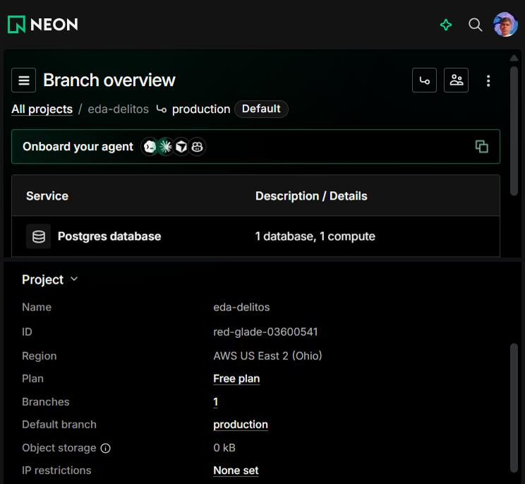

*Nota.* Elaboración propia en Neon (PostgreSQL). La captura no debe mostrar la cadena de conexión ni las credenciales.

**Figura 2**

*Definición de la tabla delitos_raw en PostgreSQL*

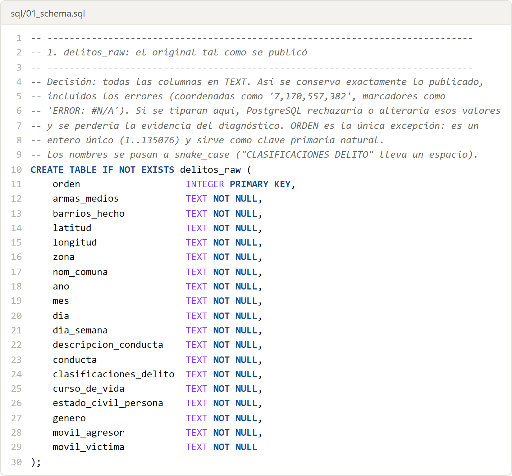

*Nota.* Elaboración propia; fragmento del archivo `sql/01_schema.sql`.

**Figura 3**

*Verificación de la carga de delitos_raw en el editor SQL de Neon*

[CAPTURA PENDIENTE: editor SQL de Neon con el resultado de la primera consulta de `sql/02_carga_verificacion.sql`]
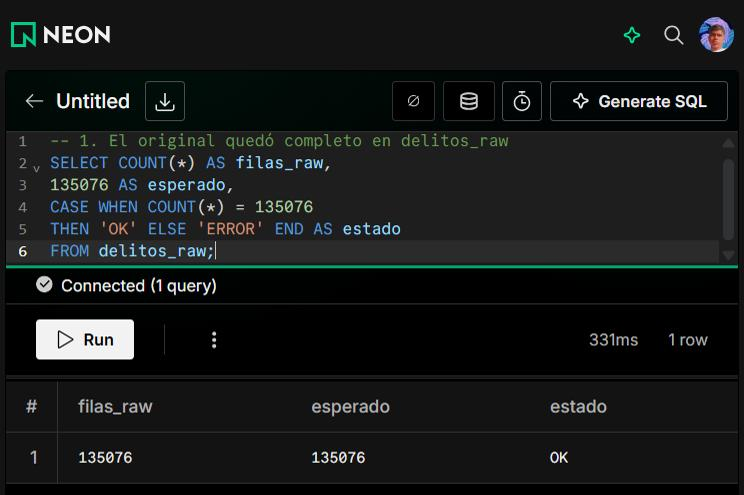

*Nota.* Elaboración propia con datos de Alcaldía de Bucaramanga (2023).

**Figura 4**

*Estructura del conjunto de datos original: variables, tipos y cardinalidad*

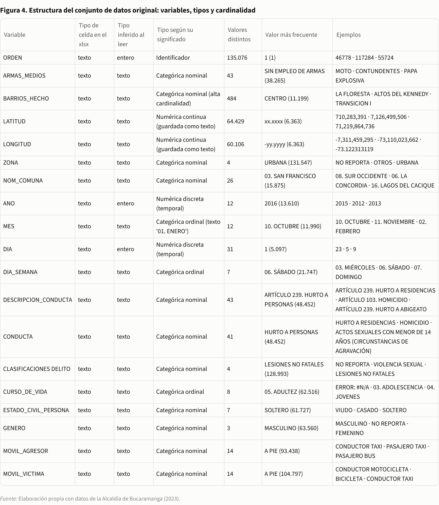

*Nota.* Elaboración propia con datos de Alcaldía de Bucaramanga (2023).

### Actividad 1.2: Identificar valores nulos, registros duplicados, errores de formato e inconsistencias.

**Valores faltantes.** El conjunto no tiene valores nulos ni celdas vacías. Los datos faltantes están escritos
como texto con marcadores distintos según la variable: «NO REPORTA», «NO REPORTADO», «SIN INFORMACION»,
«ERROR: #N/A» y «xx.xxxx» / «-yy.yyyy» en las coordenadas. En total, 24.240 registros (17,9 %) tienen al
menos un marcador.

Como se observa en la Figura 5, las variables de la víctima son las más afectadas:

- `ESTADO_CIVIL_PERSONA`: 17.134 registros (12,7 %).
- `GENERO`: 15.105 (11,2 %).
- `CURSO_DE_VIDA`: 10.941 (8,1 %). De ellos, 940 tienen el valor de error de Excel «ERROR: #N/A».

Les siguen las coordenadas, con 6.363 registros sin ubicación (4,7 %). Este patrón anticipa que el análisis
del perfil de las víctimas deberá tratar la categoría de dato faltante de forma explícita.

**Duplicados.** No hay registros duplicados completos, porque `ORDEN` es único. Sin embargo, al excluir `ORDEN`:

- **Grupos:** 8.952 registros forman 4.330 grupos de filas idénticas en las 18 columnas restantes.
- **Sobrantes:** si se conserva un registro por grupo, sobran 4.622 (3,4 %).
- **Comparación con el azar:** para saber si podían ser coincidencias, se permutó al azar el día dentro de cada
  mes en cinco repeticiones. Ese procedimiento conserva las frecuencias y rompe cualquier relación real entre
  registros. Con él se esperaban entre 360 y 399 duplicados, de modo que el valor observado es unas 12 veces
  mayor.
- **Distribución por año (Figura 6):** los duplicados se concentran en 2019, 2020 y 2021, con el 6,5 %, el
  8,8 % y el 6,7 % de los registros de cada año. Entre 2010 y 2018 oscilaban entre el 1,0 % y el 2,9 %.
- **Coincidencia con otros errores:** el aumento ocurre en los mismos años en que aparecen otros errores de
  carga, como las coordenadas intercambiadas y los días de la semana errados.
- **Ejemplos (Figura 7):** las filas de cada grupo coinciden incluso en el curso de vida, el estado civil y el
  género de la víctima.

Por estos indicios, los duplicados se interpretaron como errores de carga. Queda una limitación: como el
conjunto no incluye la hora ni un identificador de víctima, no puede descartarse que algunos grupos
correspondan a víctimas distintas de un mismo hecho con el mismo perfil.

**Coordenadas.** Las coordenadas presentan el error de formato más extendido (Figura 8):

- **Formatos:** la latitud aparece en 27 formatos de texto distintos y la longitud en 29.
- **Separadores mal ubicados:** 124.191 latitudes usan comas como separador de miles en posiciones arbitrarias.
  Por ejemplo, «7,170,557,382» corresponde a 7,170557382.
- **Intercambiadas:** 956 registros de 2020 tienen la latitud y la longitud en columnas cruzadas.
- **Sin signo:** una longitud carece de signo negativo.
- **Recuperables:** al reconstruir el valor decimal se recuperan 128.712 coordenadas dentro del área de
  Bucaramanga.
- **Irrecuperable:** un registro (ORDEN 116724) señala un punto en Bogotá y no puede corregirse.

**Rangos y fechas.** Los rangos son válidos: los años van de 2010 a 2021, los días de 1 a 31, y el número y el
nombre del mes son coherentes. No se hallaron fechas imposibles, como un 31 de febrero. Sin embargo, 577
registros de agosto de 2020 (el 83,9 % de ese mes) tienen un día de la semana que no corresponde a su fecha.

**Inconsistencias entre columnas.** La Figura 9 resume los errores de formato y las inconsistencias:

- **Otros municipios:** 166 registros asignan el hecho a otro municipio (Floridablanca 121, Girón 38,
  Medellín 3, Piedecuesta 3 y Barrancabermeja 1), a pesar de que el conjunto se refiere a Bucaramanga.
- **Barrio y comuna:** 134 barrios aparecen en más de una comuna, y 1.359 registros tienen una comuna distinta
  de la habitual de su barrio.
- **Curso de vida y estado civil:** tres registros combinan primera infancia o infancia con un estado civil de
  adulto.
- **Conducta y descripción:** dos conductas tienen una descripción alternativa en tres registros.
- **Escritura:** hay variantes del mismo valor («QUINTADANIA» y «QUINTA DANIA») y palabras escritas con y sin
  tilde.

Además, la relación entre conducta y clasificación es coherente, porque cada conducta tiene una sola
clasificación. Aun así, la fuente clasifica los 66.086 hurtos como «LESIONES NO FATALES», una particularidad
de su taxonomía que se documentó sin modificar.

**Figura 5**

*Marcadores de dato faltante por variable en el conjunto original*

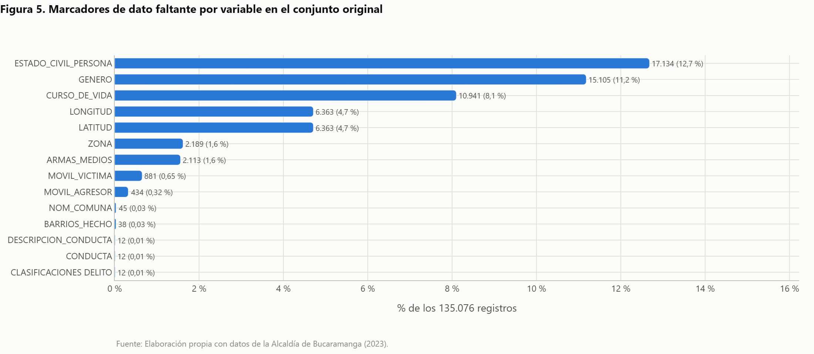

*Nota.* Elaboración propia con datos de Alcaldía de Bucaramanga (2023).

**Figura 6**

*Registros duplicados (sin considerar ORDEN) por año: observados frente a esperados por azar*

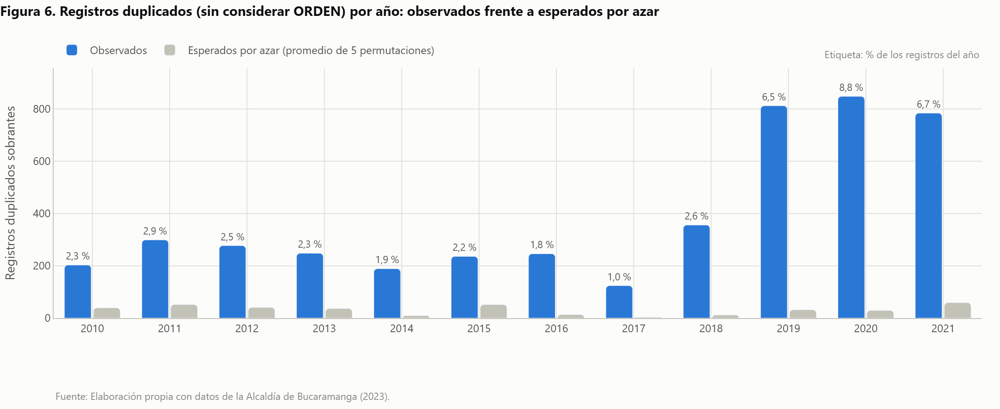

*Nota.* Elaboración propia con datos de Alcaldía de Bucaramanga (2023).

**Figura 7**

*Muestra de grupos de registros duplicados*

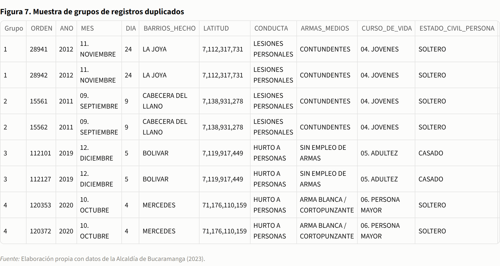

*Nota.* Elaboración propia con datos de Alcaldía de Bucaramanga (2023).

**Figura 8**

*Formatos de texto encontrados en las coordenadas*

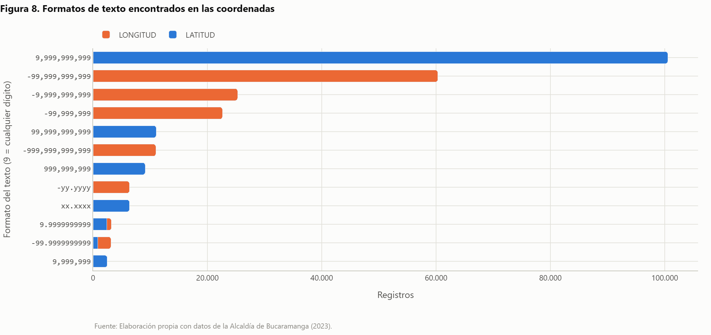

*Nota.* Elaboración propia con datos de Alcaldía de Bucaramanga (2023).

**Figura 9**

*Resumen de errores de formato e inconsistencias entre columnas*

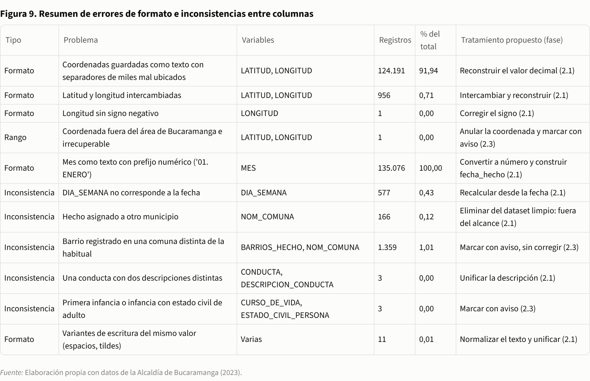

*Nota.* Elaboración propia con datos de Alcaldía de Bucaramanga (2023).

### Actividad 1.3: Documentar los problemas de calidad encontrados en un informe de diagnóstico.

Los problemas identificados se documentaron en un informe de diagnóstico que la aplicación genera de forma
automática. El informe se guarda en `docs/informe_diagnostico.md` y puede descargarse desde la página
*Diagnóstico* (Figura 10).

El informe clasifica los problemas en cuatro tipos: faltantes, duplicados, formato e inconsistencia. Para cada
uno indica las variables afectadas, el número y el porcentaje de registros, y el tratamiento propuesto, que se
aplica en la fase de limpieza. Los problemas de mayor alcance son:

- El formato de las coordenadas (91,9 % de los registros).
- Los marcadores de dato faltante (17,9 %).
- Los duplicados (3,4 %).

Los demás afectan a menos del 1,1 % de los registros cada uno. El informe establece además que ninguna
corrección se aplica sobre el original: todas se hacen sobre un conjunto de datos nuevo.

**Figura 10**

*Informe de diagnóstico de calidad generado por la aplicación*

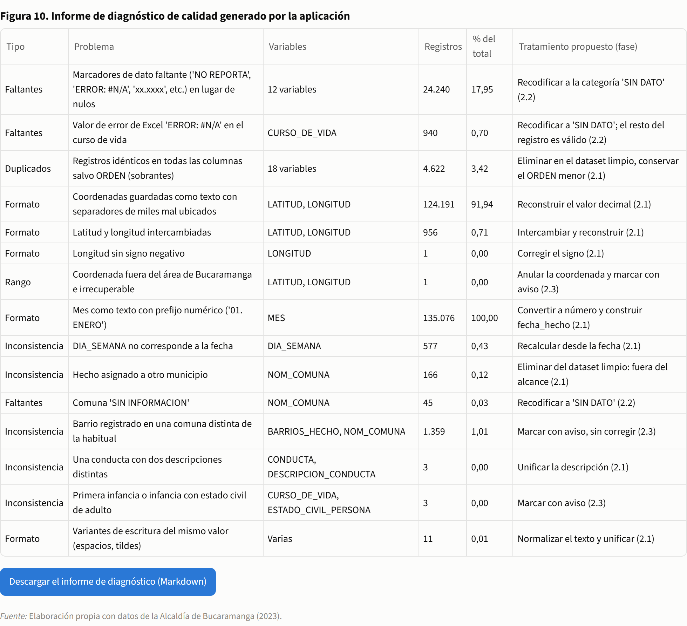

*Nota.* Elaboración propia con datos de Alcaldía de Bucaramanga (2023).

## Objetivo 2: Limpiar y preparar los datos mediante el tratamiento de valores nulos y atípicos.

### Actividad 2.1: Corregir los errores de formato y eliminar los registros duplicados o inconsistentes.

La limpieza se implementó en Python (`src/cleaning.py`) sobre una copia del original, que no se modificó, y
produjo un conjunto de datos nuevo, `delitos_limpios`. Cada decisión quedó registrada con su actividad, los
registros afectados y su justificación en una tabla de decisiones (Figura 11), que también se muestra en la
aplicación y en `docs/decisiones_limpieza.md`.

**Correcciones de formato:**

- **Texto:** se normalizaron las doce variables categóricas: mayúsculas, sin tildes (conservando la Ñ) y sin
  espacios repetidos. Esto modificó 166.992 celdas y evitó que un mismo valor, como «GARCÍA ROVIRA» y «GARCIA
  ROVIRA», se contara como dos categorías.
- **Variantes:** se unificaron tres variantes de escritura del mismo valor, que afectaban a 384 registros.
- **Fechas:** el mes se convirtió de texto a número y se construyó la fecha del hecho. El día de la semana se
  recalculó a partir de esa fecha, lo que corrigió 575 registros de agosto de 2020.
- **Coordenadas:** se reconstruyeron con la función de la Figura 12, que conserva solo los dígitos e inserta el
  punto decimal tras el primer dígito en la latitud y tras el segundo en la longitud.

La Figura 13 muestra por qué fue necesario corregir además el orden y el signo: con la sola reconstrucción
decimal, los 956 registros de 2020 con las columnas cruzadas aparecían en la longitud +71° y la latitud −7°,
lejos de Bucaramanga. Tras intercambiarlos y corregir el signo de una longitud, 124.097 registros del conjunto
limpio quedaron con una ubicación válida dentro del municipio (Figura 14).

**Eliminaciones.** Se aplicaron las dos eliminaciones aprobadas, cada una registrada en `delitos_eliminados`
con su motivo:

- **Otros municipios:** 166 registros asignados a otro municipio, fuera del alcance del estudio.
- **Duplicados exactos:** 4.613 duplicados exactos, organizados en 4.321 grupos. En cada grupo se conservó el
  registro de `ORDEN` menor.

Como se observa en la Figura 15, el conjunto limpio conserva 130.297 registros, el 96,5 % del original. No
hubo eliminaciones por errores irrecuperables: el único error imposible de corregir, una coordenada ubicada en
Bogotá, se trató anulando la coordenada y no el registro.

La eliminación de duplicados tuvo un efecto visible en la serie temporal. Diciembre de 2019 pasó de 1.911 a
1.220 registros, porque el 36,2 % de sus registros eran duplicados. Algo similar ocurrió en octubre y
noviembre de 2020, con el 33,5 % y el 36,8 %.

**Figura 11**

*Tabla de decisiones de limpieza*

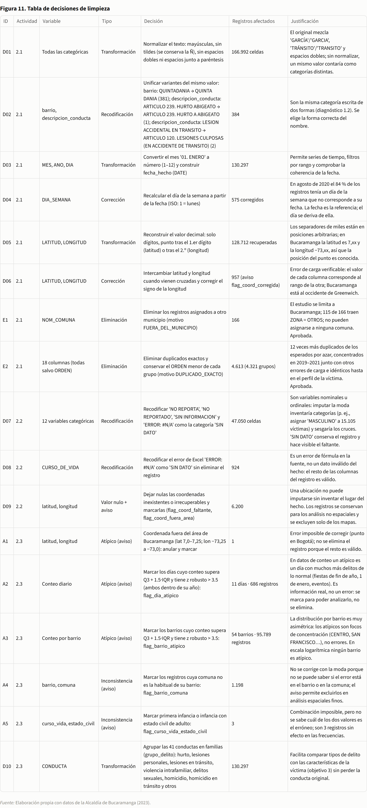

*Nota.* Elaboración propia con datos de Alcaldía de Bucaramanga (2023).

**Figura 12**

*Función de reconstrucción de las coordenadas*

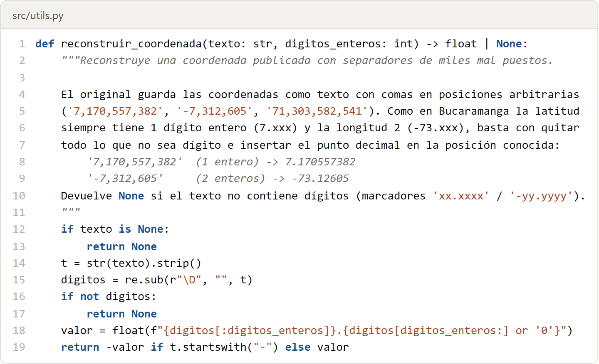

*Nota.* Elaboración propia; fragmento del archivo `src/utils.py`.

**Figura 13**

*Coordenadas con solo la reconstrucción decimal, antes de corregir intercambios y signos*

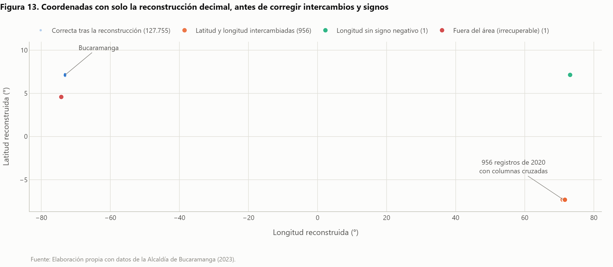

*Nota.* Elaboración propia con datos de Alcaldía de Bucaramanga (2023).

**Figura 14**

*Ubicación de los delitos con coordenadas válidas después de la corrección*

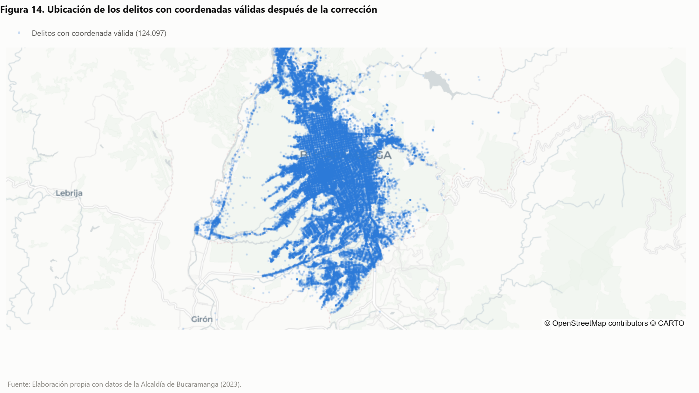

*Nota.* Elaboración propia con datos de Alcaldía de Bucaramanga (2023). Mapa base: © OpenStreetMap contributors © CARTO.

**Figura 15**

*Registros del conjunto original y del conjunto limpio, y registros eliminados por motivo*

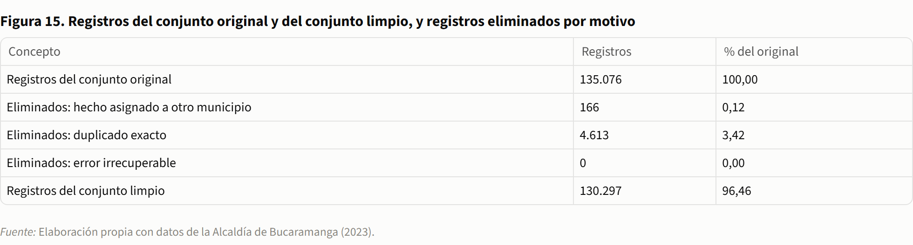

*Nota.* Elaboración propia con datos de Alcaldía de Bucaramanga (2023).

### Actividad 2.2: Aplicar técnicas de tratamiento de valores nulos según el tipo de cada variable.

La técnica de tratamiento se eligió según el tipo de cada variable (Figura 16).

**Variables categóricas.** En las doce variables categóricas, los marcadores «NO REPORTA», «NO REPORTADO»,
«SIN INFORMACION» y «ERROR: #N/A» se recodificaron como la categoría «SIN DATO», en 47.050 celdas. Se descartó
imputar con la moda: estas variables son nominales u ordinales, y asignar la categoría más frecuente, como
«MASCULINO» o «SOLTERO», a miles de víctimas habría inventado un perfil y sesgado las tablas de contingencia
del objetivo 3.

Los 924 registros con el error de Excel «ERROR: #N/A» en el curso de vida se recodificaron sin eliminarse,
porque el resto de sus columnas es válido. En el conjunto limpio, «SIN DATO» representa:

- El 12,5 % del estado civil.
- El 11,1 % del género.
- El 8,3 % del curso de vida.

**Coordenadas.** Las 6.200 coordenadas inexistentes o irrecuperables se dejaron como valores nulos,
identificados con los avisos `flag_coord_faltante` y `flag_coord_fuera_area`. Una ubicación no puede imputarse
sin inventar el lugar del hecho, así que estos registros se conservan para todos los análisis excepto los mapas.

**Figura 16**

*Tratamiento de los valores faltantes según el tipo de variable*

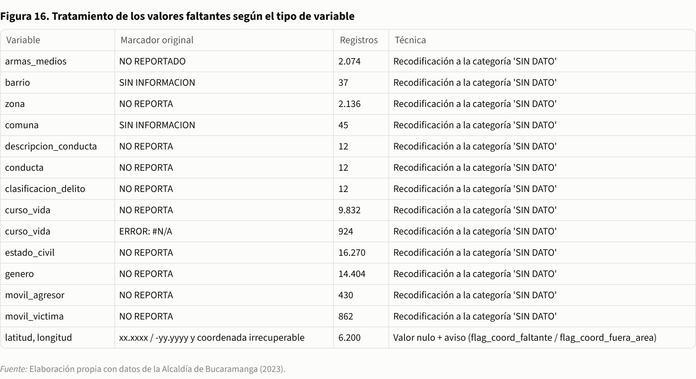

*Nota.* Elaboración propia con datos de Alcaldía de Bucaramanga (2023).

### Actividad 2.3: Detectar y tratar los valores atípicos, y validar el conjunto de datos resultante.

**Qué es un atípico en este conjunto.** Como las variables del conjunto son categóricas, los atípicos se
buscaron en los conteos que resultan de agregarlas: delitos por día y delitos por barrio. En datos de conteo,
un atípico no es un error de digitación sino un periodo o un lugar con muchos más delitos de lo habitual, por
lo que se marcó con avisos y no se eliminó.

**Método.** Se combinaron dos criterios, y un valor se consideró atípico solo si ambos coincidían:

- **Límite de Tukey:** el valor supera Q3 + 1,5·IQR.
- **z robusto** de Iglewicz y Hoaglin: z mayor que 3,5, calculado con la mediana y la desviación absoluta
  mediana. Este criterio no se distorsiona por los mismos extremos que se busca detectar.

**Conteo diario.** Los umbrales se calcularon dentro de cada año, porque el nivel general cambia entre años
(Figura 17).

- **Días atípicos:** de 4.383 días, el límite de Tukey señaló 42 y el z robusto 11. Los 11 que cumplen ambos
  criterios agrupan 686 registros, marcados con `flag_dia_atipico`.
- **Fechas:** cuatro de esos días son un 1 de enero, y uno es la Navidad de 2012.
- **Efecto de los duplicados:** antes de eliminarlos, los picos más altos de la serie estaban en diciembre de
  2019. Con ellos, esos días habrían parecido atípicos.
- **Día 1 del mes:** tiene 4.920 registros, frente a una media de 4.279 en los días 2 a 28. Este exceso podría
  deberse a fechas registradas por defecto.
- **Días sin registros:** del 27 al 31 de marzo de 2019 no hay ningún registro. Probablemente es un hueco en la
  carga de datos.

Ambas situaciones del día 1 y de marzo de 2019 se documentaron como limitaciones.

**Conteo por barrio.** La distribución es muy asimétrica (Figura 18): la mediana es de 46 delitos por barrio,
mientras que CENTRO registra 10.740.

- **Escala lineal:** 54 de los 438 barrios superan ambos criterios y concentran el 73,5 % de los registros.
  Se marcaron con `flag_barrio_atipico`.
- **Escala logarítmica:** ningún barrio es atípico (z robusto máximo de 2,27), lo que indica una cola larga y
  no valores imposibles.
- **Lectura:** los barrios marcados se interpretan como focos de concentración del delito, que se analizan en el
  objetivo 3.

**Inconsistencias marcadas.** También se marcaron, sin corregirlas:

- **Barrio y comuna:** 1.198 registros cuya comuna no es la habitual de su barrio (`flag_barrio_comuna`).
- **Curso de vida y estado civil:** 3 registros de primera infancia o infancia con estado civil de adulto.

En ambos casos no es posible saber cuál de los dos valores es el erróneo.

**Validación.** El conjunto limpio superó las 18 pruebas de la Figura 19:

- Limpios más eliminados suman 135.076.
- Cada registro está en una sola tabla.
- No quedan duplicados según el criterio aprobado ni marcadores de faltante.
- Las fechas son coherentes con el año, el mes, el día y el día de la semana.
- Las coordenadas están dentro del área de Bucaramanga.
- Las categorías y los tipos de dato son los permitidos.

Estas pruebas coinciden con las restricciones `CHECK` del esquema de `delitos_limpios` en PostgreSQL, de modo
que la base de datos rechazaría cualquier registro que no las cumpliera.

**Carga en Neon.** El conjunto limpio se cargó en `delitos_limpios` (130.297 registros) y el registro de
eliminaciones en `delitos_eliminados` (4.779 registros). La verificación con `sql/02_carga_verificacion.sql`
dio estado OK en todas las consultas (Figura 20):

- La suma de ambas tablas es igual a los 135.076 registros de `delitos_raw`.
- Ningún registro está en las dos tablas ni quedó sin destino.
- Los conteos cuadran año por año y conducta por conducta.

Además, los avisos, las coordenadas y el rango de fechas almacenados en Neon coinciden exactamente con los del
archivo local.

**Figura 17**

*Diagramas de caja del número de delitos por día, por año*

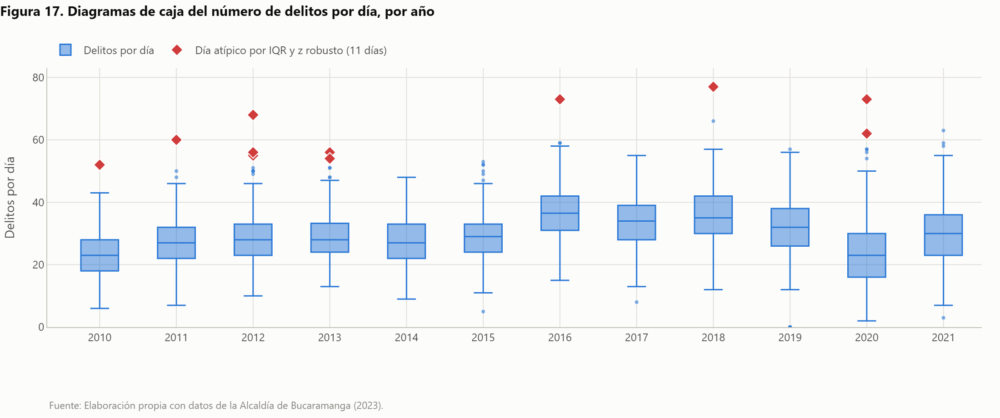

*Nota.* Elaboración propia con datos de Alcaldía de Bucaramanga (2023).

**Figura 18**

*Diagramas de caja del número de delitos por barrio en escala lineal y logarítmica*

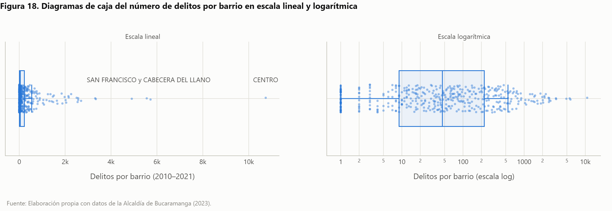

*Nota.* Elaboración propia con datos de Alcaldía de Bucaramanga (2023).

**Figura 19**

*Validación del conjunto de datos limpio*

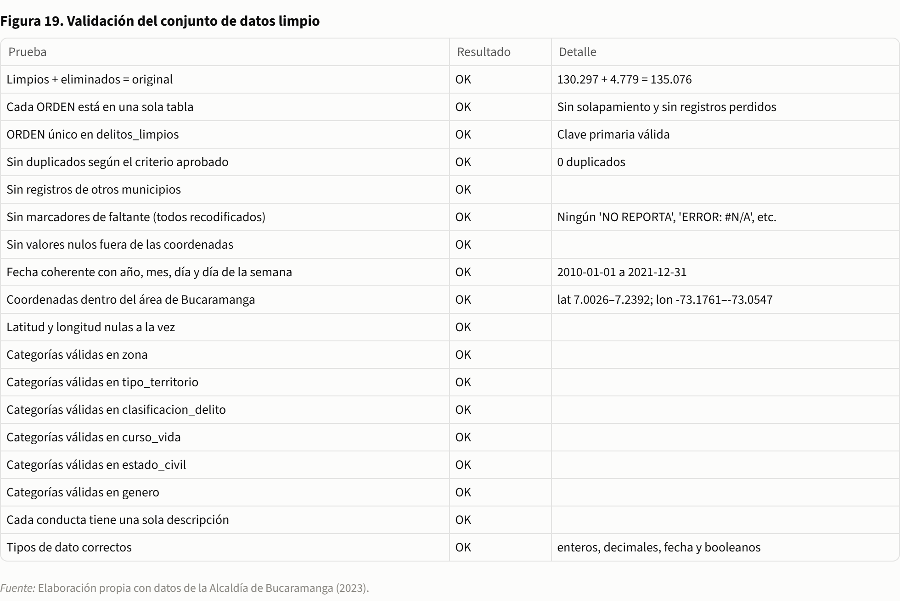

*Nota.* Elaboración propia con datos de Alcaldía de Bucaramanga (2023).

**Figura 20**

*Verificación de la carga de delitos_limpios y delitos_eliminados en el editor SQL de Neon*

[CAPTURA PENDIENTE: editor SQL de Neon con el resultado de las consultas 2 y 4 de `sql/02_carga_verificacion.sql`]
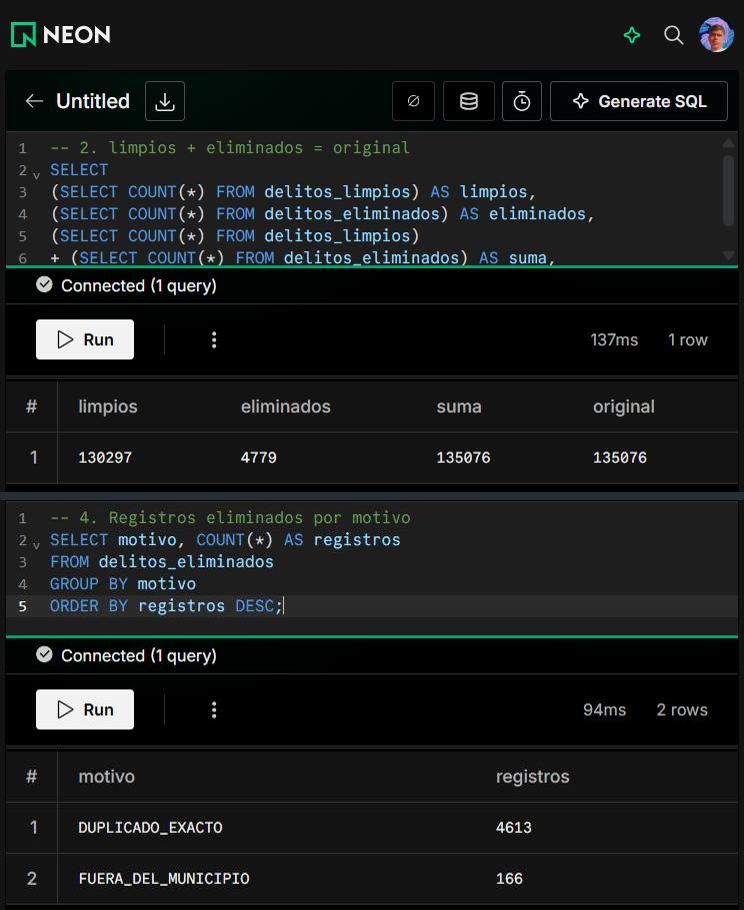

*Nota.* Elaboración propia con datos de Alcaldía de Bucaramanga (2023).

## Objetivo 3: Describir la distribución de los delitos en el espacio, en el tiempo y según el perfil de las víctimas mediante análisis exploratorio.

### Actividad 3.1: Calcular las estadísticas descriptivas y las frecuencias de cada variable.

El análisis exploratorio se hizo sobre los 130.297 registros del conjunto limpio (`src/eda.py`) y se presenta
en la página *Análisis exploratorio* de la aplicación. Esa página permite filtrar por rango de años, comuna,
tipo de delito y género; las cifras de este apartado corresponden al conjunto completo.

**Variables categóricas.** Como todas las variables del conjunto son categóricas, se describieron con
frecuencias y porcentajes (Figura 21).

- **Tipo de delito (Figura 22):** el hurto es el más frecuente (48,96 % de los registros), seguido de las
  lesiones personales (18,07 %), las lesiones en accidentes de tránsito (15,28 %) y la violencia intrafamiliar
  (12,53 %). Estos cuatro grupos suman el 94,8 % de los registros.
- **Arma o medio:** predominan los hechos sin empleo de armas (28,26 %) y con objetos contundentes (27,80 %).
- **Víctima:** el 46,88 % de los registros corresponde a hombres y el 42,06 % a mujeres; el 46,31 % a adultos
  y el 31,89 % a jóvenes. El 77,95 % de las víctimas se desplazaba a pie.
- **Zona:** el 97,46 % de los hechos ocurrió en zona urbana.

**Conteos.** Las únicas magnitudes numéricas son los conteos que resultan de agregar los registros. Sus
estadísticas descriptivas (Figura 23) muestran dos comportamientos opuestos:

- **Por día:** el conteo es casi simétrico (Figura 24). La media es de 29,73 delitos, la mediana de 29, la
  desviación estándar de 9,33 y la asimetría de 0,20.
- **Por barrio:** el conteo está muy sesgado a la derecha (Figura 25). La mediana es de 46 delitos, la media de
  297,40, la asimetría de 7,01 y el coeficiente de variación de 277 %. Es decir, unos pocos barrios concentran
  una gran parte de los registros, mientras que la mayoría registra pocos hechos en todo el periodo.

**Figura 21**

*Frecuencias y porcentajes de las categorías principales de las variables del delito y de la víctima*

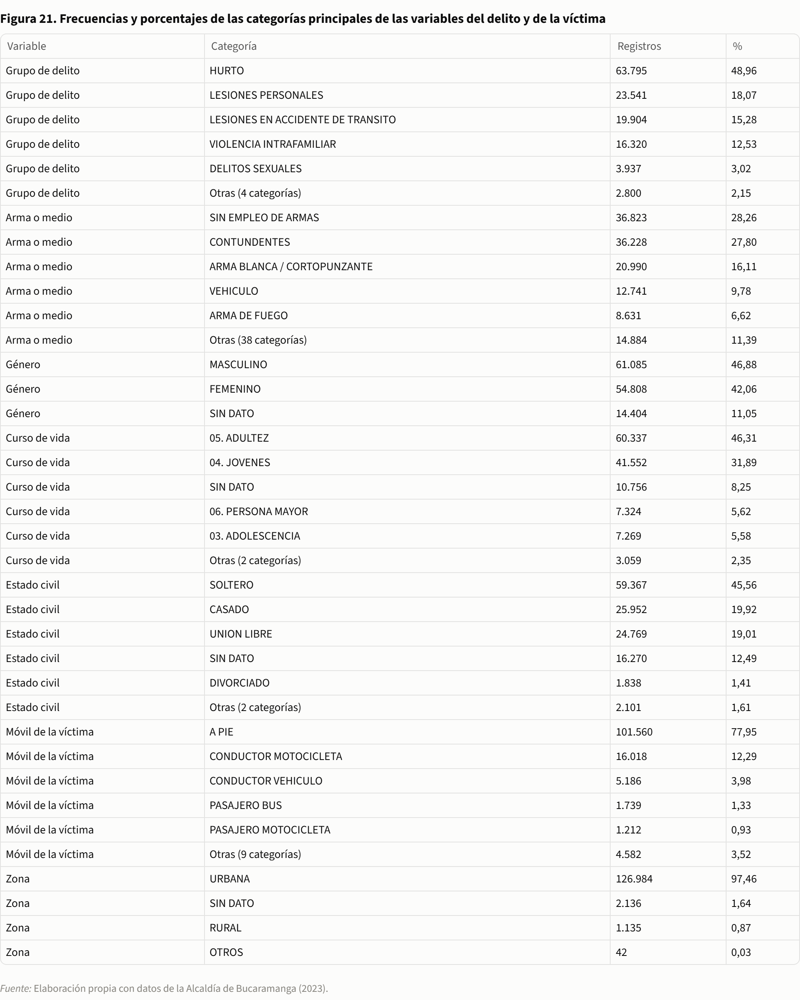

*Nota.* Elaboración propia con datos de Alcaldía de Bucaramanga (2023).

**Figura 22**

*Registros por grupo de delito, 2010–2021*

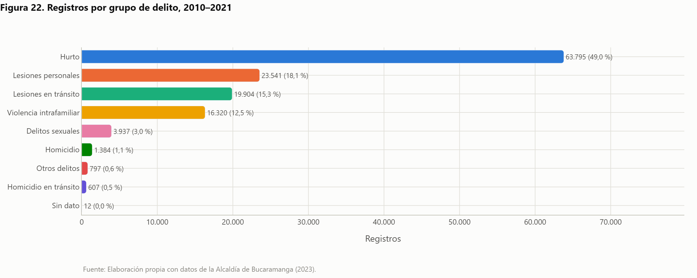

*Nota.* Elaboración propia con datos de Alcaldía de Bucaramanga (2023).

**Figura 23**

*Estadísticas descriptivas de los conteos de delitos por día, mes, barrio y comuna*

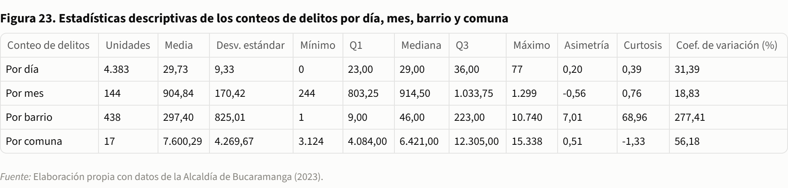

*Nota.* Elaboración propia con datos de Alcaldía de Bucaramanga (2023).

**Figura 24**

*Histograma del número de delitos registrados por día*

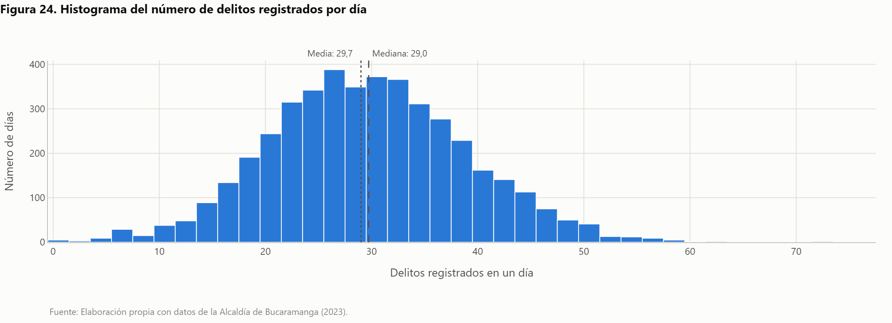

*Nota.* Elaboración propia con datos de Alcaldía de Bucaramanga (2023).

**Figura 25**

*Histograma del número de delitos registrados por barrio*

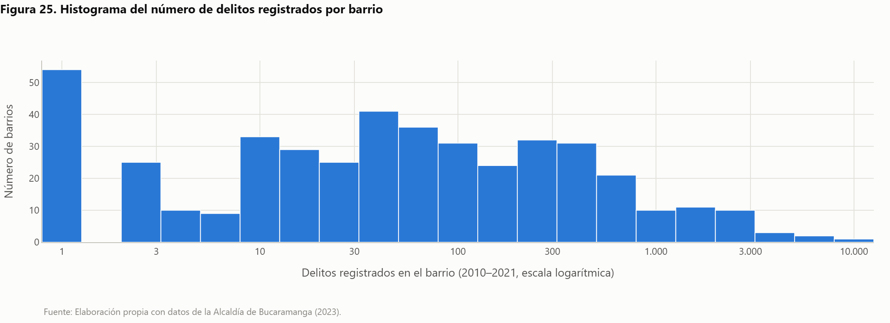

*Nota.* Elaboración propia con datos de Alcaldía de Bucaramanga (2023).

### Actividad 3.2: Analizar la distribución de los delitos por zona geográfica y por periodo de tiempo.

**Distribución en el tiempo**

- **Por año (Figura 26):** los registros pasaron de 8.488 en 2010 a un máximo de 13.354 en 2016. El hurto es el
  grupo que más creció: de 3.348 registros en 2010 a 7.753 en 2018. Otras series muestran quiebres bruscos:
  - Las lesiones en tránsito caen de 2.578 a 1.204 entre 2016 y 2017.
  - Los delitos sexuales bajan de 461 a 129 entre 2018 y 2019.

  Estos quiebres pueden reflejar cambios en el registro de la fuente y no solo en la ocurrencia de los
  delitos, por lo que deben interpretarse con cautela.
- **Por mes (Figura 27):** la serie es estable alrededor de unos 900 registros mensuales. Tiene una caída abrupta
  en abril de 2020, el mínimo del periodo con 244 registros, que coincide con la cuarentena nacional. Enero de
  2020 es el máximo, con 1.299.
- **Por día de la semana (Figura 28):** el sábado concentra el 16,08 % de los registros, 12,6 % por encima del
  promedio diario; los demás días tienen entre el 13,70 % y el 14,33 %.
- **Mapas de calor:** el de mes y año (Figura 29) muestra el bloque de valores altos de 2016 a 2019 y los valores
  bajos de abril y mayo de 2020. El de día de la semana y mes (Figura 30) ubica el promedio diario más alto en
  los sábados de febrero (38,3 delitos) y el más bajo en los lunes de junio (24,9).

**Cambio en 2020.** Frente al promedio de 2017–2019, los registros de 2020 cayeron un 29,4 % en total (Figura 31).

- **Mayores descensos:** violencia intrafamiliar (−64,0 %), delitos sexuales (−61,6 %) y lesiones en tránsito
  (−55,4 %). El hurto bajó un 23,1 %.
- **Descensos que ya venían de antes:** parte de estos descensos había comenzado en 2019. Frente a 2019, los
  delitos sexuales incluso aumentaron un 7,0 % en 2020.
- **Aumento de los homicidios:** pasaron de un promedio de 97,7 a 253 registros, un aumento del 159,0 % que
  rompe con la estabilidad de los años anteriores y merece verificarse contra otras fuentes.

**Distribución en el espacio**

- **Comunas (Figura 32):** San Francisco (11,77 %), Centro (10,21 %), Oriental (10,06 %), Cabecera del Llano
  (9,46 %) y Norte (9,44 %) suman el 50,94 % de los registros. Los tres corregimientos rurales suman el 0,80 %.
- **Barrios (Figura 33):** el barrio Centro es el de más registros, con 10.740 (8,24 % del total), seguido de San
  Francisco y Cabecera del Llano. Los veinte primeros barrios acumulan el 49,45 % de los registros.
- **Concentración de los hurtos (Figura 34):** **15 de los 409 barrios con hurtos (3,67 %) concentran el 50 %**,
  con un índice de Gini de 0,834. Los cinco primeros son Centro, Cabecera del Llano, San Francisco, La Concordia
  y San Alonso.
- **Concentración de todos los delitos:** con todos los delitos juntos, la mitad de los registros se concentra
  en 21 de 438 barrios (4,8 %).

**Figura 26**

*Registros por año de los cinco grupos de delito más frecuentes*

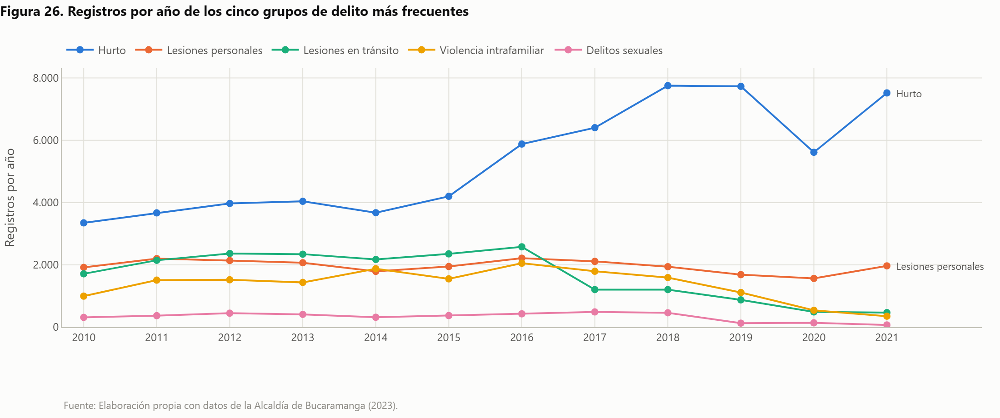

*Nota.* Elaboración propia con datos de Alcaldía de Bucaramanga (2023).

**Figura 27**

*Serie mensual de registros de delitos, 2010–2021*

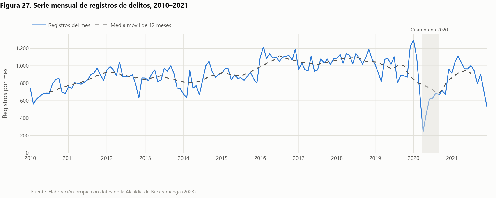

*Nota.* Elaboración propia con datos de Alcaldía de Bucaramanga (2023).

**Figura 28**

*Registros por día de la semana*

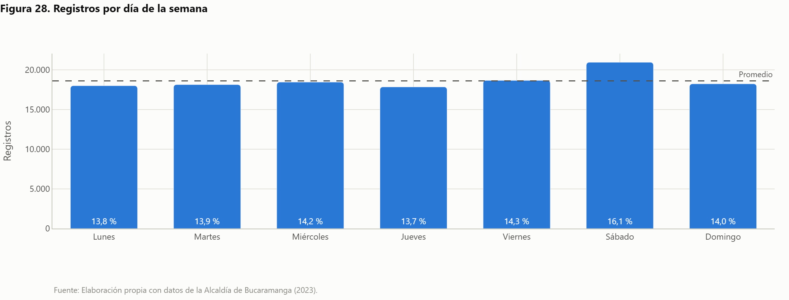

*Nota.* Elaboración propia con datos de Alcaldía de Bucaramanga (2023).

**Figura 29**

*Mapa de calor de registros por mes y año*

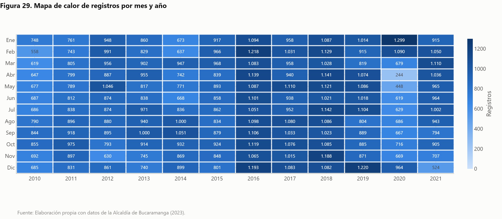

*Nota.* Elaboración propia con datos de Alcaldía de Bucaramanga (2023).

**Figura 30**

*Mapa de calor del promedio diario de delitos por día de la semana y mes*

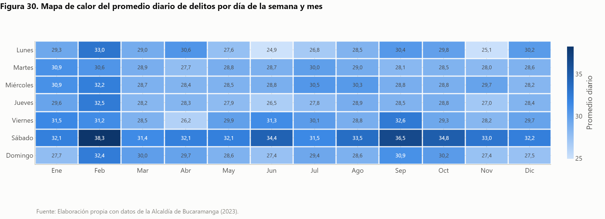

*Nota.* Elaboración propia con datos de Alcaldía de Bucaramanga (2023).

**Figura 31**

*Variación de los registros de 2020 frente al promedio 2017–2019, por grupo de delito*

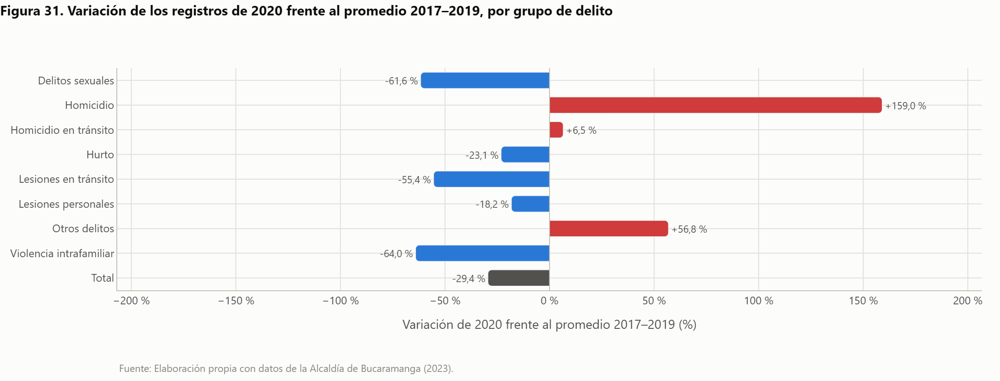

*Nota.* Elaboración propia con datos de Alcaldía de Bucaramanga (2023).

**Figura 32**

*Registros por comuna y corregimiento*

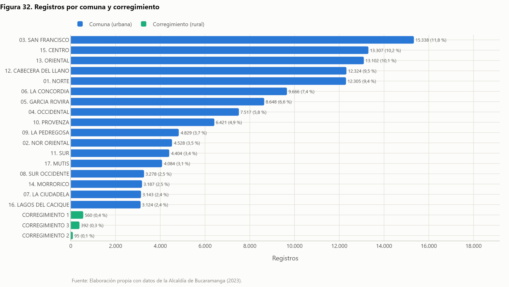

*Nota.* Elaboración propia con datos de Alcaldía de Bucaramanga (2023).

**Figura 33**

*Los veinte barrios con más registros de delitos*

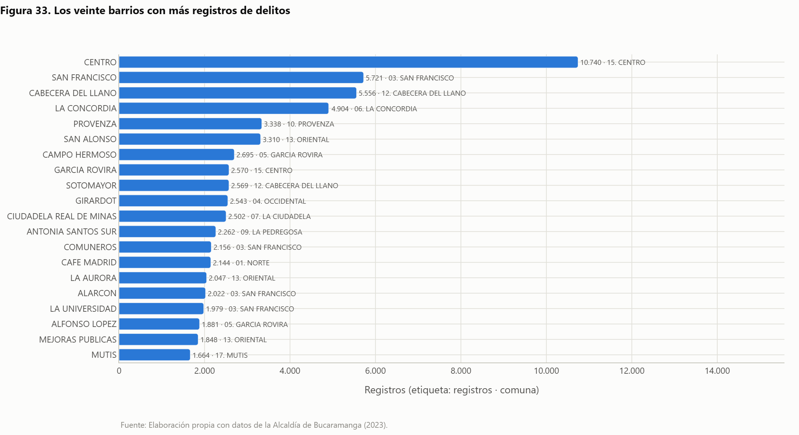

*Nota.* Elaboración propia con datos de Alcaldía de Bucaramanga (2023).

**Figura 34**

*Curva de concentración de los hurtos por barrio*

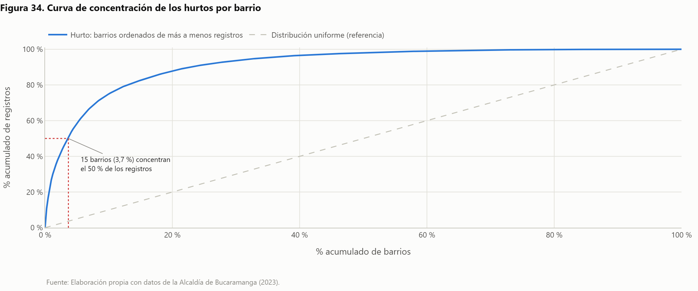

*Nota.* Elaboración propia con datos de Alcaldía de Bucaramanga (2023).

### Actividad 3.3: Cruzar los tipos de delito con las características de las víctimas mediante tablas de contingencia.

**Método.** Se construyeron tablas de contingencia entre el grupo de delito y el género, el curso de vida y el
estado civil de la víctima (Figuras 35 a 37), expresadas como porcentaje por fila.

- **Independencia:** se evaluó con la prueba de chi-cuadrado de Pearson.
- **Fuerza de la asociación:** se midió con la V de Cramér, interpretada con los umbrales de Cohen (1988)
  ajustados al número de categorías.
- **Exclusiones:** los registros «SIN DATO» se excluyeron de cada prueba, por ser ausencia de información y no
  una categoría de la víctima.

**Resultados.** Las tres pruebas rechazan la independencia (p < 0,001), con ningún valor esperado menor que 5 en
género y curso de vida, y el 4,2 % en estado civil (Figura 38). La fuerza de la asociación varía:

- **Género:** asociación moderada (V = 0,344). Las mujeres son el 83,3 % de las víctimas de violencia
  intrafamiliar y el 84,2 % de las de delitos sexuales, mientras que los hombres son el 87,3 % de las víctimas de
  homicidio y el 57,0 % de las de hurto.
- **Curso de vida:** asociación fuerte según el umbral ajustado (V = 0,236 con seis categorías). El rasgo más
  marcado es que el 76,2 % de las víctimas de delitos sexuales son menores de 18 años: primera infancia 17,0 %,
  infancia 21,9 % y adolescencia 37,3 %. En los demás grupos predominan los adultos y los jóvenes. Las personas
  mayores representan el 29,8 % de las víctimas de homicidio en accidentes de tránsito.
- **Estado civil:** asociación moderada (V = 0,152). El 93,7 % de las víctimas de delitos sexuales son
  solteras, lo que es coherente con su edad. El 45,4 % de las víctimas de violencia intrafamiliar vive en unión
  libre.

**Correlaciones.** Para cumplir el requisito de analizar correlaciones, los registros se agregaron por barrio y
año (5.256 combinaciones) y se calculó la correlación de Spearman entre los conteos de los seis grupos
principales (Figura 39).

- **Resultados:** todas las correlaciones son positivas y significativas (p < 0,001). Las más altas se dan entre
  hurto y lesiones personales (ρ = 0,77) y entre lesiones personales y violencia intrafamiliar (ρ = 0,74).
  Las más bajas involucran al homicidio (ρ entre 0,38 y 0,49).
- **Dispersión (Figura 40):** muestra la relación entre hurtos y violencia intrafamiliar por barrio y año
  (ρ = 0,69).
- **Lectura:** los barrios donde hay más delitos de un tipo tienden a tener más de los otros. Sin embargo, como
  el conjunto no incluye la población de cada barrio, esta correlación refleja en parte el tamaño y la actividad
  de cada zona y no implica una relación causal entre los delitos.

**Figura 35**

*Tabla de contingencia del grupo de delito por género de la víctima (porcentaje por fila)*

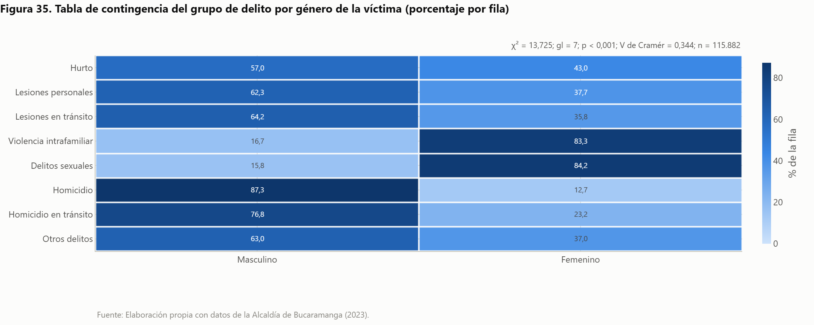

*Nota.* Elaboración propia con datos de Alcaldía de Bucaramanga (2023).

**Figura 36**

*Tabla de contingencia del grupo de delito por curso de vida de la víctima (porcentaje por fila)*

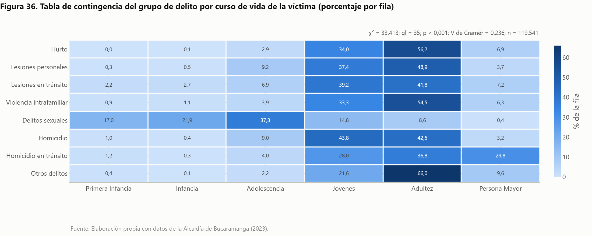

*Nota.* Elaboración propia con datos de Alcaldía de Bucaramanga (2023).

**Figura 37**

*Tabla de contingencia del grupo de delito por estado civil de la víctima (porcentaje por fila)*

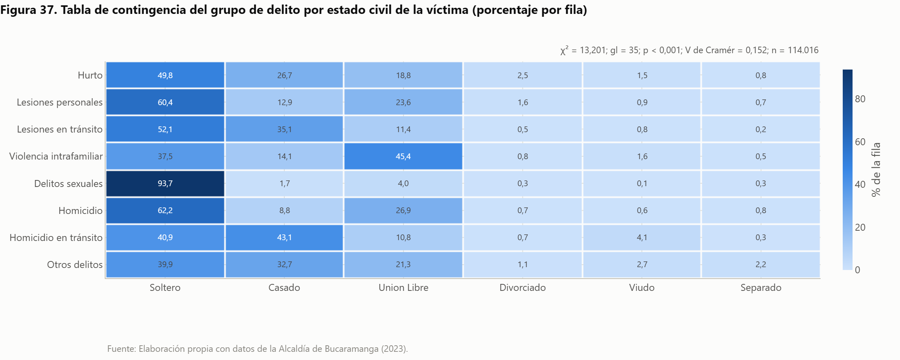

*Nota.* Elaboración propia con datos de Alcaldía de Bucaramanga (2023).

**Figura 38**

*Pruebas de chi-cuadrado y V de Cramér entre el grupo de delito y las características de la víctima*

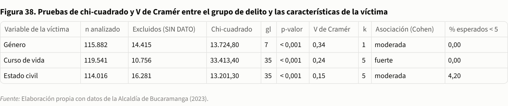

*Nota.* Elaboración propia con datos de Alcaldía de Bucaramanga (2023).

**Figura 39**

*Correlación de Spearman entre los conteos de grupos de delito por barrio y año*

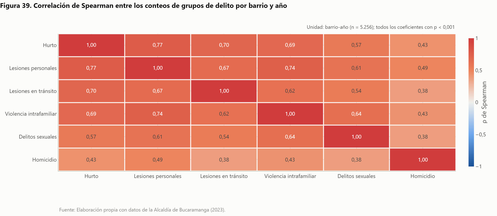

*Nota.* Elaboración propia con datos de Alcaldía de Bucaramanga (2023).

**Figura 40**

*Dispersión de hurtos y casos de violencia intrafamiliar por barrio y año*

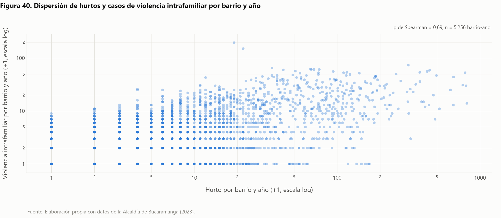

*Nota.* Elaboración propia con datos de Alcaldía de Bucaramanga (2023).

## Objetivo 4: Visualizar los patrones delictivos identificados mediante gráficos y mapas.

### Actividad 4.1: Seleccionar los tipos de gráficos más adecuados para cada tipo de variable y análisis.

El tipo de gráfico se seleccionó según el tipo de variable y la pregunta de cada análisis (Figura 41):

- **Variables categóricas:** barras horizontales ordenadas, porque la longitud se compara con más precisión que
  el ángulo de un gráfico circular y las etiquetas largas se leen mejor.
- **Distribución de los conteos:** histogramas para la forma y diagramas de caja para los atípicos.
- **Variables temporales:** series de tiempo, y mapas de calor para los cruces de mes con año y de día de la
  semana con mes.
- **Variaciones con signo:** barras divergentes.
- **Concentración espacial:** una curva de concentración y mapas de densidad.
- **Relación entre dos variables categóricas:** tablas de contingencia como mapas de calor del porcentaje por
  fila.
- **Correlación entre conteos:** matriz de Spearman y gráfico de dispersión.

Se aplicaron además criterios comunes:

- Un solo eje vertical por gráfico.
- Color según su función: secuencial para magnitudes, divergente para variaciones y un color fijo por grupo de
  delito.
- Una paleta validada para daltonismo.
- Un título numerado y la fuente en cada figura.

**Figura 41**

*Criterios de selección del tipo de gráfico según la variable y el análisis*

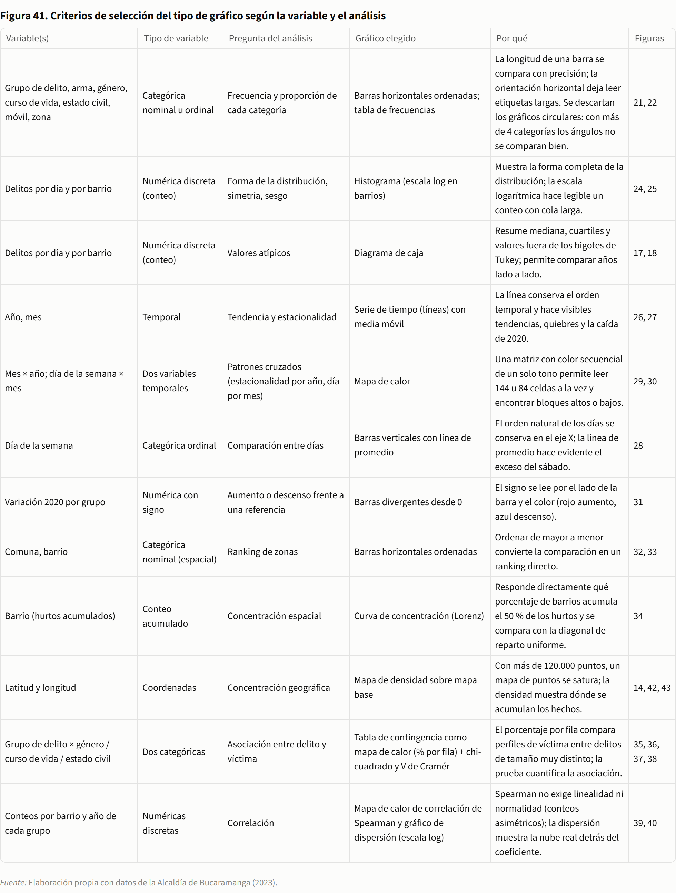

*Nota.* Elaboración propia con datos de Alcaldía de Bucaramanga (2023).

### Actividad 4.2: Elaborar los gráficos, como series de tiempo, barras y mapas de calor, y los mapas de concentración por zona.

**Gráficos.** Los gráficos se elaboraron con plotly y son interactivos en la aplicación: muestran el valor al
pasar el cursor y permiten acercar y descargar la imagen. Comprenden las series de tiempo, las barras, los mapas
de calor, los diagramas de caja, los histogramas y los gráficos de dispersión presentados en los objetivos 2 y 3.
Las versiones del artículo se exportaron como imágenes con kaleido.

**Mapas de concentración.** Se elaboraron mapas de densidad con los 124.097 registros que tienen una coordenada
válida, agrupados en 3.361 celdas de unos 110 metros (Figura 42). Agrupar por celdas evita que la densidad
calculada punto a punto sature el mapa.

- **Mapa general:** la mayor densidad se ubica en el centro de la ciudad y en los ejes viales que lo conectan
  con el norte y con Cabecera del Llano.
- **Mapas por grupo (Figura 43):** muestran que los delitos no se concentran igual. El hurto se concentra con
  fuerza en el centro, mientras que la violencia intrafamiliar y las lesiones personales se distribuyen de
  forma más dispersa hacia las zonas residenciales del norte y de la periferia.
- **Delitos sexuales sin ubicación:** no aparecen en los mapas porque la fuente no publica su ubicación. Los
  4.047 registros de violencia sexual del original traen el marcador «xx.xxxx». En el conjunto limpio son el
  63,5 % de las 6.200 coordenadas faltantes, lo que indica que ese faltante no es aleatorio y probablemente
  responde a la protección de las víctimas. Su distribución espacial solo puede analizarse por barrio y comuna.

**Tablero de Power BI.** El tablero final se construyó en Power BI, conectado a Neon mediante cinco vistas que
forman un modelo en estrella (`sql/03_vistas_powerbi.sql`):

- Una vista de hechos (Figura 44).
- Cuatro vistas de dimensiones: tiempo, territorio, conducta y víctima.

**Verificación de las vistas.** Las vistas se crearon en Neon y se comprobaron:

- **Tamaño:** la vista de hechos tiene 130.297 registros. Las dimensiones tienen 4.383 fechas, 609 combinaciones
  de comuna y barrio, 41 conductas y 92 perfiles de víctima, con una sola fila por clave.
- **Relaciones:** todos los hechos encuentran su fila en cada dimensión.
- **Cifras de referencia:** calculadas directamente sobre las vistas, coinciden con las de Python: 48,96 % de
  hurto, 11,05 % de género sin dato y San Francisco como la comuna con más casos (11,77 %).

**Conexión segura.** La conexión usa un rol de solo lectura, y las credenciales no se almacenan en el archivo
del tablero.

**Contenido del tablero (Figuras 45 y 46):**

- **Medidas DAX:** total de delitos, variación porcentual anual, porcentaje de hurto, porcentaje de «SIN DATO»
  y participación de la comuna con más casos.
- **Segmentadores:** año, comuna, grupo de delito y género.

**El tablero (Figura 46).** El proyecto de Power BI se generó por código (`src/powerbi.py`) y usa un tema
visual de seguridad ciudadana: fondo oscuro, cifras en rojo de alerta y un color fijo por grupo de delito,
ordenado por gravedad. La página contiene:

- **Indicadores:** seis tarjetas.
- **Segmentadores:** cuatro, por año, comuna, grupo de delito y género.
- **Visuales:**
  - La serie mensual, que reproduce la caída de abril de 2020.
  - Las barras por grupo de delito y por comuna.
  - Una matriz de mes por año con formato condicional en degradado rojo, que funciona como mapa de calor.

**Validación.** Sin filtros, el tablero reproduce las cifras de referencia calculadas en Python
(`docs/powerbi_guia.md`):

- 130.297 delitos.
- Variación del último año de +25,3 % (2021 frente a 2020).
- 49 % de hurto.
- 11,1 % de registros sin dato de género.
- San Francisco como la comuna con más casos, con el 11,8 %.

**Figura 42**

*Mapa de densidad de los delitos con ubicación válida, 2010–2021*

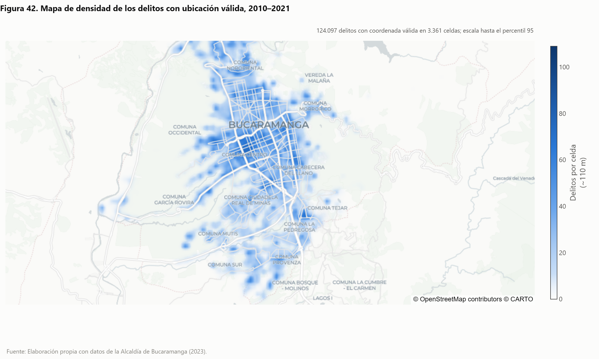

*Nota.* Elaboración propia con datos de Alcaldía de Bucaramanga (2023). Mapa base: © OpenStreetMap contributors © CARTO.

**Figura 43**

*Mapas de densidad por grupo de delito*

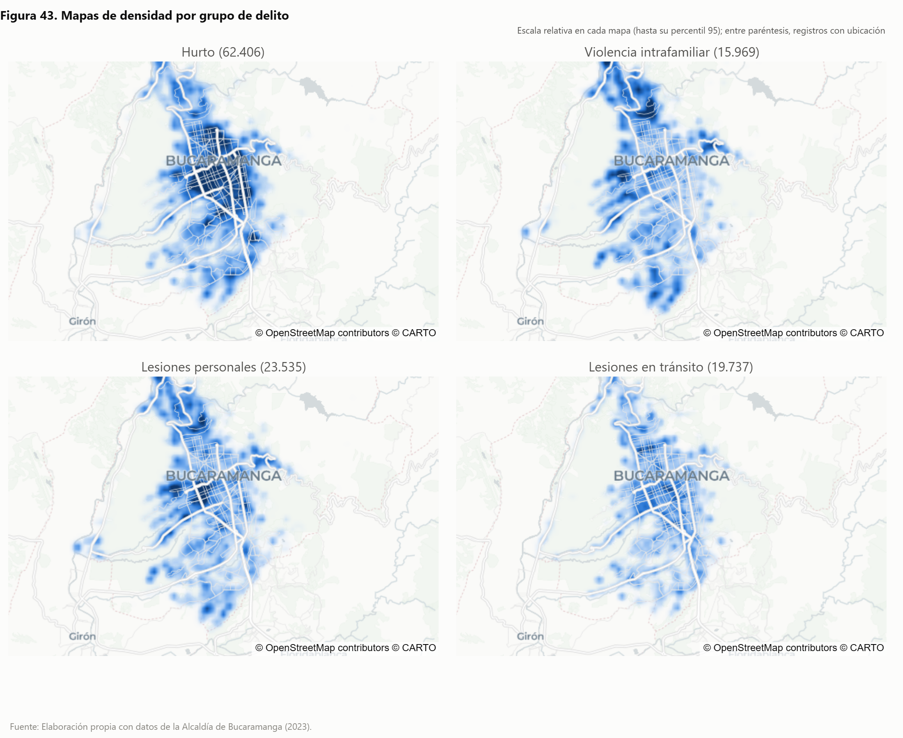

*Nota.* Elaboración propia con datos de Alcaldía de Bucaramanga (2023). Mapa base: © OpenStreetMap contributors © CARTO.

**Figura 44**

*Vista de hechos para Power BI en PostgreSQL*

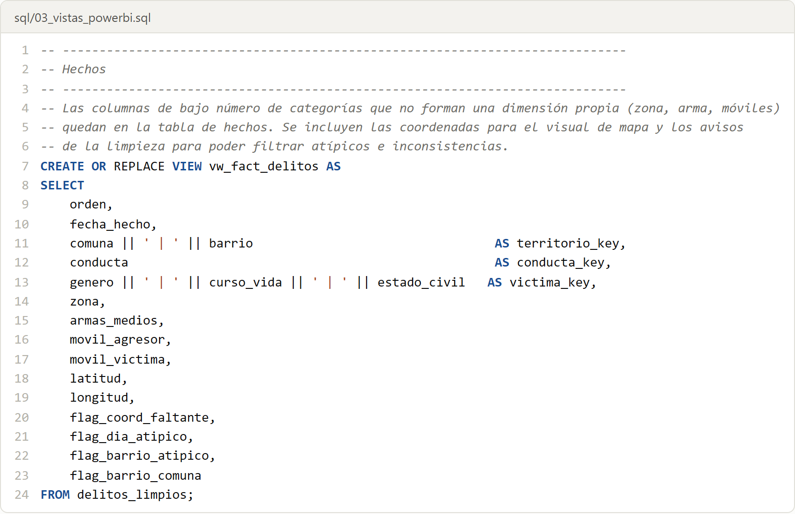

*Nota.* Elaboración propia; fragmento del archivo `sql/03_vistas_powerbi.sql`.

**Figura 45**

*Modelo de datos en estrella en Power BI*

[CAPTURA PENDIENTE: vista de modelo de Power BI con las cinco vistas y sus relaciones]
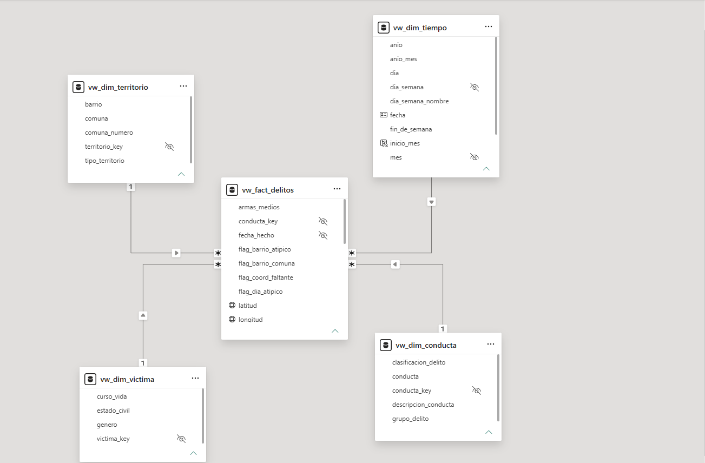

*Nota.* Elaboración propia en Power BI con datos de Alcaldía de Bucaramanga (2023).

**Figura 46**

*Tablero de Power BI con indicadores, segmentadores y visualizaciones*

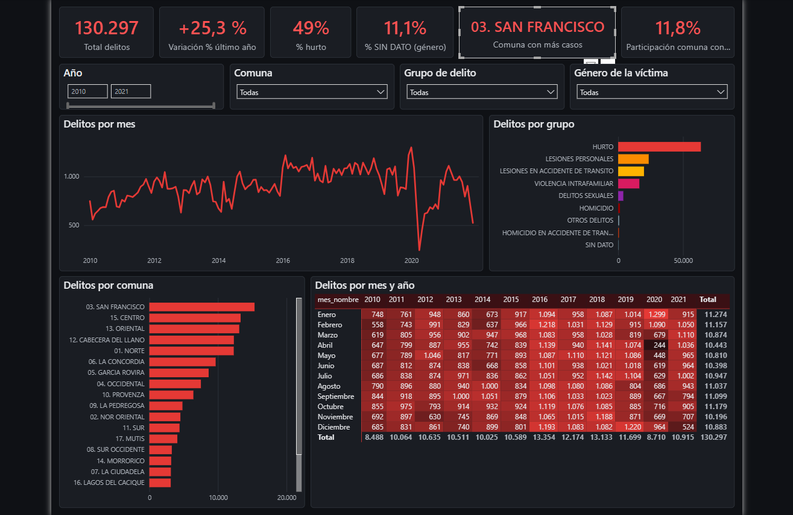

*Nota.* Elaboración propia en Power BI con datos de Alcaldía de Bucaramanga (2023).

### Actividad 4.3: Interpretar los patrones observados en las visualizaciones y contrastarlos con los antecedentes.

Los patrones identificados se reunieron en la página *Visualización y hallazgos* de la aplicación (Figura 47).
Cada hallazgo tiene su cifra principal, su evidencia gráfica y un espacio para el contraste con los
antecedentes. A continuación se resumen los siete hallazgos.

**H1. Concentración espacial del hurto.** El 50 % de los hurtos ocurrió en 15 de los 409 barrios con hurtos
(3,7 %), con un índice de Gini de 0,83 (Figura 34). Encabezan la lista Centro, Cabecera del Llano, San
Francisco, La Concordia y San Alonso, y el mapa de densidad confirma el foco en el centro de la ciudad
(Figura 43). La concentración sugiere que la prevención focalizada en pocos barrios abarcaría una parte
importante del problema. Una limitación es que el conjunto no incluye la población ni la actividad comercial
de los barrios, que permitirían calcular tasas.

*Contraste con los antecedentes:* [PENDIENTE: escriba aquí el contraste con los antecedentes]

**H2. Predominio y crecimiento del hurto.** El hurto representa el 48,96 % de los registros. Pasó de 3.348 en
2010 a 7.753 en 2018 (131,6 % más) y, tras la caída de 2020, volvió a 7.520 en 2021 (Figura 26).

*Contraste con los antecedentes:* [PENDIENTE]

**H3. Perfil de género según el tipo de delito.** La asociación entre el grupo de delito y el género es
moderada (V de Cramér = 0,344; Figura 35):

- Las mujeres son el 83,3 % de las víctimas de violencia intrafamiliar y el 84,2 % de las de delitos sexuales.
- Los hombres son el 87,3 % de las víctimas de homicidio y el 57,0 % de las de hurto.

*Contraste con los antecedentes:* [PENDIENTE]

**H4. Violencia sexual contra niños, niñas y adolescentes.** El 76,2 % de las víctimas de delitos sexuales es
menor de 18 años: primera infancia 17,0 %, infancia 21,9 % y adolescencia 37,3 % (Figura 36). Es el único grupo
de delito cuyas víctimas son mayoritariamente menores de edad.

*Contraste con los antecedentes:* [PENDIENTE]

**H5. Caída de 2020 y recuperación de 2021.** Los registros de 2020 fueron un 29,4 % menores que el promedio de
2017–2019 (Figura 31). Abril de 2020 tiene el mínimo de la serie, con 244 registros, en coincidencia con la
cuarentena (Figura 27). En 2021 los registros aumentaron un 25,3 %.

Sin embargo, el cambio no se explica solo por la pandemia:

- La violencia intrafamiliar y los delitos sexuales ya venían bajando en 2019.
- Los homicidios aumentaron en 2020, de un promedio de 98 a 253 registros, un dato que conviene verificar con
  otras fuentes.

*Contraste con los antecedentes:* [PENDIENTE]

**H6. Mayor ocurrencia los sábados.** El sábado concentra el 16,08 % de los registros, un 12,6 % por encima del
promedio diario; los demás días son parejos (Figura 28). El patrón se repite en casi todos los meses (Figura 30).

*Contraste con los antecedentes:* [PENDIENTE]

**H7. La calidad del registro condiciona la lectura de las tendencias.** Los errores de carga se concentran en
2019–2021 (Figura 6):

- **Duplicados:** en diciembre de 2019, 691 de 1.911 registros (36,2 %) eran duplicados, y sin la limpieza esos
  días habrían parecido picos reales.
- **Quiebres en las series:** hay saltos bruscos en las lesiones en tránsito (2017) y en los delitos sexuales
  (2019).
- **Huecos:** del 27 al 31 de marzo de 2019 no hay ningún registro.
- **Ubicaciones no publicadas:** los delitos sexuales no tienen ubicación.

Por eso las tendencias de los últimos años deben leerse como tendencias del registro, y no necesariamente de la
ocurrencia.

*Contraste con los antecedentes:* [PENDIENTE]

**Figura 47**

*Página de hallazgos de la aplicación: patrón, cifra, evidencia y contraste con los antecedentes*

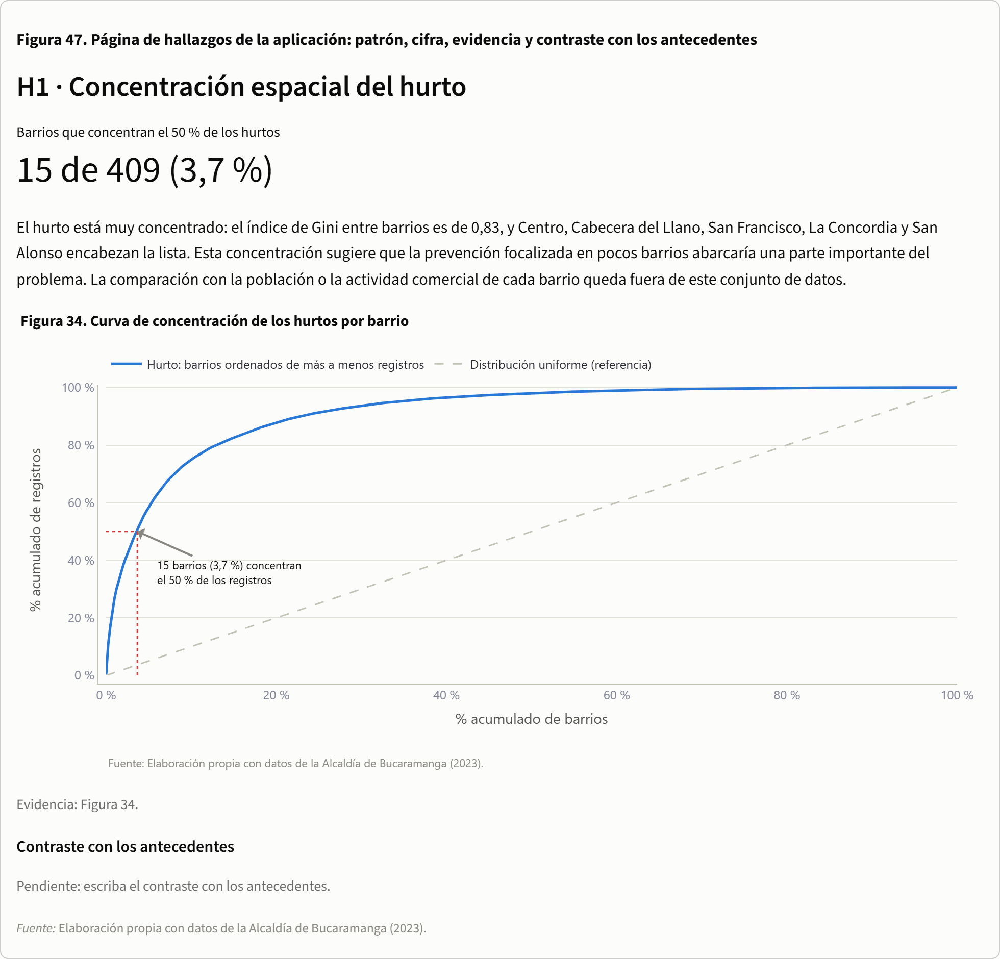

*Nota.* Elaboración propia con datos de Alcaldía de Bucaramanga (2023).
